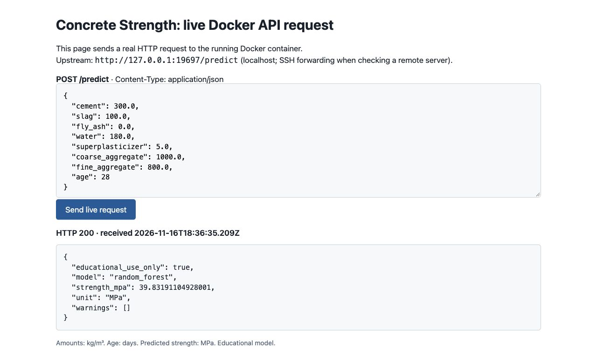

# Concrete Strength Prediction

ML Zoomcamp 2026 Midterm: estimate concrete compressive strength in MPa from
seven ingredient quantities and curing age.

The project compares Ridge regression, a decision tree and a random forest,
tunes their parameters, exports the selected model and serves it as a JSON API.
The intended use is an educational estimate of the effect of mixture composition
and age. It is not a substitute for laboratory testing or an engineering approval.

Russian startup and submission instructions: [START_HERE_RU.md](START_HERE_RU.md).

## Data

Source: I-Cheng Yeh, [Concrete Compressive Strength, UCI](https://doi.org/10.24432/C5PK67).
License: [CC BY 4.0](https://creativecommons.org/licenses/by/4.0/).
The original XLS and readme are included in `data/raw/`; `data/concrete.csv`
contains the same 1,030 rows with shorter column names. `data/source.json`
records download URL, original column mapping and SHA-256 checksums.

| Input | Meaning | Unit |
|---|---|---|
| `cement` | Cement | kg/m³ |
| `slag` | Blast furnace slag | kg/m³ |
| `fly_ash` | Fly ash | kg/m³ |
| `water` | Water | kg/m³ |
| `superplasticizer` | Superplasticizer | kg/m³ |
| `coarse_aggregate` | Coarse aggregate | kg/m³ |
| `fine_aggregate` | Fine aggregate | kg/m³ |
| `age` | Curing age | whole days |

Target: `strength_mpa`, measured compressive strength in MPa.
There are no missing values. Training removes 25 exact duplicate rows,
leaving 1,005 observations and 428 distinct ingredient recipes. Zeros in
optional ingredients are valid, not missing data.

Data retrieval is optional because all data is already bundled:

```bash
python download_data.py
```

This command requires the notebook dependencies (`xlrd` reads the original XLS).
It checks the official archive against the included checksum before replacing data.
No Kaggle account or API key is required.

## Method and results

The train/validation/test partition is by the seven ingredient quantities,
excluding age. All observations of one identical recipe stay together.
This tests generalization to unseen recipes rather than allowing the same
mixture at different ages into different partitions.

- Seed: 42. Train: 595 rows; validation: 204; test: 206.
- GroupShuffleSplit uses approximately 60/20/20 of the recipe groups, not rows.
- EDA uses training data: ranges, target distribution, scatter plots, correlations.
- Three model families are tuned with five-fold GroupKFold on training data only.
- Ridge scaling is fit inside each CV fold using a Pipeline.
- Candidate family is selected by validation RMSE, then fit on train + validation.
- The held-out test is used after model/parameter selection is frozen.
- A mean-prediction baseline and permutation importance are included.

Main metric: `RMSE = sqrt(mean((actual - predicted)^2))`, in MPa; lower is better.
MAE and R² are also reported. The target is not log-transformed.

| Tuned model | CV RMSE (MPa) | Validation RMSE (MPa) |
|---|---:|---:|
| Random forest | 5.971 | 6.135 |
| Ridge | 10.336 | 10.359 |
| Decision tree | 7.887 | 10.624 |

Selected: random forest, 150 trees, unlimited depth, one sample per leaf,
seed 42. The final model is refit on 799 train+validation rows.
On 206 held-out test rows: **RMSE 6.650 MPa, MAE 4.632 MPa, R² 0.863**.
The mean-prediction baseline has test RMSE **18.016 MPa**.

Training EDA shows positive linear correlations of strength with cement (0.45)
and age (0.33), and a negative correlation with water (-0.25).
The selected model's strongest validation permutation importances are age,
cement and water. The forest achieved lower validation RMSE than Ridge on this
split, suggesting that nonlinear relationships or interactions help prediction.
The decision tree's low training error and much larger validation error indicate
overfitting despite CV tuning.

Measured results are in `results/model_comparison.csv` and
`results/final_metrics.json`; all 18 parameter configurations and their five-fold
scores are in `results/cv_results.csv`. The executed notebook includes tables and
five plots. `results/split_manifest.csv` records exact split membership.

## Run locally

Use Python 3.12. Start with a fresh clone on macOS or Linux:

```bash
git clone https://github.com/kirillkaryagin/concrete-strength-prediction.git
cd concrete-strength-prediction
python3.12 -m venv .venv
source .venv/bin/activate
python -m pip install -r requirements.txt
python serve.py
```

On Windows, create the environment with `py -3.12 -m venv .venv` and activate
with `.venv\Scripts\Activate.ps1` in PowerShell before the same pip/Python commands.

The bundled `model.pkl` is ready for the pinned runtime versions. Only load model
artifacts from a trusted source; pickle can execute code. The service does not
accept model uploads. A scikit-learn version mismatch fails startup explicitly.

The service listens at `http://127.0.0.1:9696`, accessible from the same computer.
Waitress is used instead of Flask's development server. Stop it with Ctrl+C.

In another terminal, from the same directory, activate the environment again:

```bash
source .venv/bin/activate
curl -sS http://127.0.0.1:9696/health
curl -sS -X POST http://127.0.0.1:9696/predict \
  -H 'Content-Type: application/json' \
  --data-binary @sample_request.json
python smoke_check.py
```

In Windows PowerShell, use the following commands instead:

```powershell
.venv\Scripts\Activate.ps1
curl.exe -sS http://127.0.0.1:9696/health
curl.exe -sS -X POST http://127.0.0.1:9696/predict -H "Content-Type: application/json" --data-binary "@sample_request.json"
python smoke_check.py
```

`GET /health` returns service status and selected model.
`POST /predict` accepts exactly the eight fields in `sample_request.json` and
returns `strength_mpa`, `unit`, `model`, `warnings`, `educational_use_only`.
The bundled example returned this actual response during the local HTTP check:

```json
{
  "educational_use_only": true,
  "model": "random_forest",
  "strength_mpa": 39.83191104928001,
  "unit": "MPa",
  "warnings": []
}
```

All values must be finite JSON numbers, not strings or booleans. Amounts must
be between 0 and 2,000 kg/m³; cement, water and both aggregates must be positive.
Age must be an integer from 1 to 365. These are input sanity limits, not a
guarantee of a feasible recipe. Values outside observed training ranges produce
warnings. Unknown or missing fields and invalid values return HTTP 400;
non-JSON bodies return 415; bodies above 8 KiB return 413. The server also has
a separate 16 KiB transport limit. No API authentication is configured; the
documented default binds to localhost.

## Reproduce training and the notebook

Rebuild the final model using the frozen selection from the notebook:

```bash
python train.py
```

This writes `model.pkl`, final metrics, predictions and split manifest.
It reuses the fixed partition and hyperparameters; it does not search against test.

To reproduce EDA, the entire search and selection process, install the additional
notebook dependencies and use the environment's kernel:

```bash
python -m pip install -r requirements-notebook.txt
python -m ipykernel install --user --name concrete-strength --display-name 'Python (concrete-strength)'
python -m notebook notebook.ipynb
```

Select **Python (concrete-strength)**, then **Restart Kernel and Run All Cells**.
This kernel selection ensures packages are installed in the Python actually
running the notebook. Running the notebook overwrites the generated model and
results. It does not start a background API server.

## Docker

Docker Engine must already be installed on the machine where these commands run.
It can be a separate Linux server; Docker on your laptop is not required.
Stop a previously started local `python serve.py` with Ctrl+C first, so port
9696 is free. The following commands use a macOS/Linux shell and require curl.

```bash
docker build -t concrete-strength:midterm .
docker run -d --name concrete-strength-demo \
  -p 127.0.0.1:9696:9696 concrete-strength:midterm
```

Wait up to 30 seconds for startup; continue only if this prints `API is ready`:

```bash
for attempt in $(seq 1 30); do
  if curl --fail --silent http://127.0.0.1:9696/health; then
    echo ' API is ready'
    break
  fi
  sleep 1
done
```

Then send requests:

```bash
curl -sS http://127.0.0.1:9696/health
curl -sS -X POST http://127.0.0.1:9696/predict \
  -H 'Content-Type: application/json' --data-binary @sample_request.json
python3 smoke_check.py
```

`smoke_check.py` uses only Python's standard library. It needs Python 3 on the
host, but no scikit-learn, Flask or Jupyter installation outside the container.

The image includes the trained model and inference code, runs as a non-root user
and has a health check. The container listens on 0.0.0.0 internally; the published
host port above is restricted to localhost. Inference dependencies are separate
from Jupyter and data-conversion dependencies.

Remove only this example container and image after testing:

```bash
docker rm -f concrete-strength-demo
docker image rm concrete-strength:midterm
```

## Verification evidence

The project was checked again from a fresh GitHub clone in a new Python 3.12
virtual environment. Both requirements files installed successfully and pip
reported no dependency conflicts. The notebook executed all 12 code cells and
produced five plots. Model selection and all test predictions matched the
published version exactly. Standalone `train.py` also reproduced the predictions.
The local API passed all 13 HTTP contract checks. The optional official data
download/conversion script reproduced the bundled CSV checksum.

The Linux server independently cloned the project, built the Dockerfile
and started the container with a host-published port:
`-p 127.0.0.1:19696:9696`. Port 19696 was chosen to avoid conflicts; it uses the
same Docker port mapping as the 9696 example above. All 13 HTTP checks passed
through the server's host port. The image ran as UID 10001 and the container's
model checksum matched the repository artifact.



This is an actual, unmodified browser screenshot after clicking **Send live
request**. The browser client forwarded the request through an SSH tunnel to
the server's published Docker port and displayed the returned HTTP 200 and
prediction. It does not load saved prediction results. The small client is
included as `verification/demo_client.py`; it uses only Python's standard library.

Evidence files:

- `results/fresh_clone_verification.json`: clean clone, package versions,
  notebook execution, standalone training and local API checks.
- `results/docker_host_verification.json`: server clone, image, real host-port
  HTTP checks, port bindings, model checksum and cleanup.
- `results/docker_host_build.log` and `results/docker_host_curl.txt`: build output
  and the actual curl response, including HTTP headers. Temporary image tags
  are omitted from build logs; the image ID and model checksum are retained.
- `results/browser_live_request.jsonl`: request and response captured by the
  live screenshot client.

The reports identify the tested source files and model by SHA-256 checksums.
The model, notebook code, inference code and dependency files remain unchanged.
Older `api_local.json`, `docker_verification.json` and `deployment_proof.png`
record the initial verification; the older PNG is a rendered transcript, not
the new browser screenshot.

The server's existing Docker storage was nearly full. Verification therefore
used a separate temporary daemon and data directory. For the second check it
used a dedicated bridge and Docker's userland port proxy; firewall management
was disabled. Only localhost was exposed. The container, bridge, image,
temporary daemon, test client and SSH tunnel were removed after verification.
There is no persistent public endpoint.

### Reproduce the browser demonstration

Start the container as described above. In another terminal run:

```bash
python3 verification/demo_client.py --upstream http://127.0.0.1:9696
```

Open `http://127.0.0.1:19876/` in your browser and click **Send live request**.
For a remote server, first forward its loopback API port:

```bash
ssh -N -L 127.0.0.1:19697:127.0.0.1:9696 YOUR_USER@YOUR_SERVER
```

Then start the client with `--upstream http://127.0.0.1:19697`. Replace the
SSH user and host with your own. Stop the client and tunnel with Ctrl+C.

The PNG files show EDA, correlation, model comparison, feature importance,
and actual versus predicted test values. The notebook contains embedded outputs.
`notebook.html` is a static copy for viewing in a browser without Jupyter.

## Limitations

The source has no reliable batch/manufacturer identifiers. Recipe grouping
protects identical compositions, but not near-identical mixtures or all forms
of source dependence. Other curing conditions and material properties are not
available. External validation on another producer has not been performed.
Permutation importance describes this model, not causal effects.
